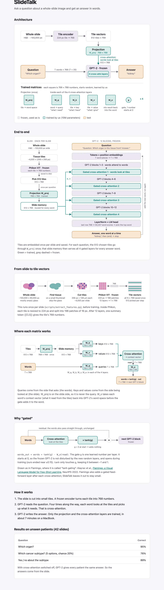

# SlideTalk

Ask a question about an H&E whole-slide image and get an answer in words.

A frozen GPT-2 learns to look at the slide through 4 gated cross-attention layers. Only those layers and
one projection are trained (10M parameters), in about 8 minutes on an M3 MacBook. It is a small teaching
prototype of the idea behind slide-language models such as Prov-GigaPath and Flamingo.



**Why "gated".** Each cross-attention layer adds what it read from the slide back to the words as
`words + tanh(g) · W_o(read)`, where `g` is one learned number per layer that starts at 0. So at the start
the new, randomly initialised layers add nothing and the frozen GPT-2 works exactly as released; the gates
open during training. This is the "tanh gating" of Flamingo
([Alayrac et al., NeurIPS 2022](https://arxiv.org/abs/2204.14198)), without its extra gated feed-forward layer.

Inside each gated layer, `W_q`, `W_k` and `W_v` find what to read; `W_o` maps what was read back into
GPT-2's word space before the gate adds it:

```
word ──► query ──► compares with tile keys ──► weights ──► context vector (read)
                                                              │
                                                              ▼  × W_o
                                                 word + tanh(g) · (read · W_oᵀ)
```

## Results

42 slides from patients never seen in training (5 TCGA subtypes: lung adenocarcinoma, lung squamous,
clear cell, papillary and chromophobe renal cell carcinoma).

| Question | Correct |
|---|---|
| Which organ? | 95% |
| Which cancer subtype? (5 options, chance 20%) | 76% |
| Yes / no about the subtype | 89% |
| Pick between the subtypes of that organ | 79% |

With cross-attention switched off, GPT-2 gives every patient the same answer; shown another patient's
slide, the answer follows the slide shown. So the answers come from the slide.

## Run it

Python 3.11. Slides are downloaded from the public [NIH GDC](https://portal.gdc.cancer.gov/) (TCGA,
open access); Phikon and GPT-2 come from Hugging Face.

```bash
python -m venv .venv && source .venv/bin/activate
pip install -r requirements.txt

python -m pytest tests -q              # model checks, no data needed
python scripts/extract_features.py     # download, tile and embed the 300 slides in data/manifest.csv
python scripts/train.py                # train cross-attention (about 8 min on an M3)
python scripts/test.py                 # accuracy on held-out patients + controls
python scripts/chat.py                 # ask questions about a test slide
```

`extract_features.py` streams one slide at a time (download, embed, delete), so disk use stays at a
couple of slides; it resumes where it stopped. `--limit 25` gives a quick start with fewer slides.
Each chat answer also saves an attention map (which tiles the answer looked at) in `runs/slidetalk/`.

## Layout

```
slidetalk/model.py         gated cross-attention + frozen GPT-2
slidetalk/data.py          labels, questions, tile sampling
slidetalk/evaluate.py      asking questions and scoring answers
slidetalk/prep/            GDC download, tissue tiling, Phikon tile encoder
scripts/                   extract_features, train, test, chat
data/manifest.csv          the 300 slides used (60 per subtype)
data/splits.csv            train / val / test, split by patient
```
